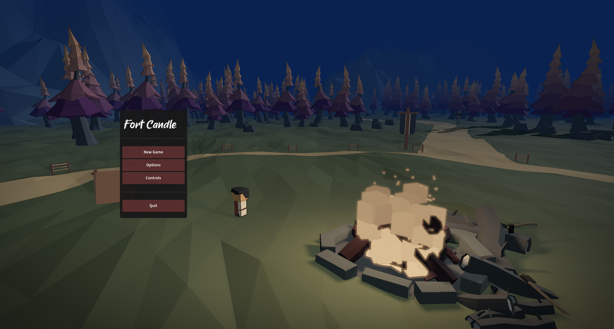
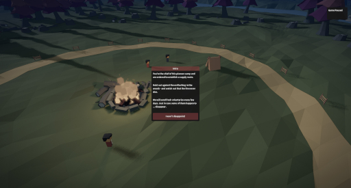
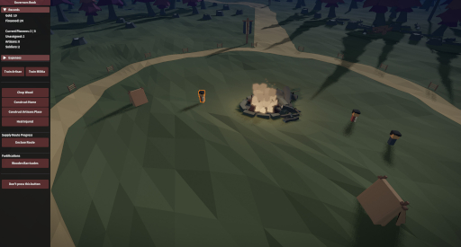
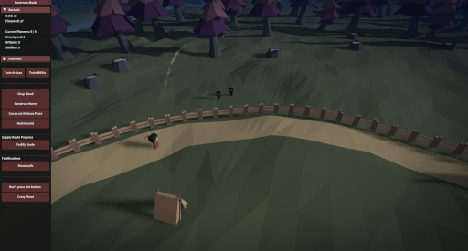
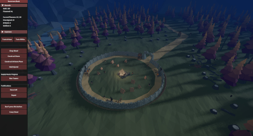

> [!IMPORTANT]
> This is the `v2` branch. It deviates more broadly from the original university code and receives active development.
> See [`v1`](https://github.com/jfmilke/Fort-Candle/tree/v1) for the original code with only minimal fixes to keep it running.

# Fort Candle

Result of the GameDevelopment Practical 2021 at RWTH Aachen.
Features a small strategy game which only aims to demonstrate the capabilities of the self-designed game engine.

**Note:** This is a reupload to GitHub from another inaccessible Git repository, initially reflecting the code state at submission.
Since then, the build was modernized for current compilers, the vendored libraries were updated to current upstream versions, and a few bugs were fixed.



## Gameplay

The gameplay mechanics consist of resource management (gold, wood, people), base building, economy and combat.
The goal is to survive against waves of enemies until the victory condition is met.

> You are the commander of the upstream encampment Fort Candle.
> Your goal is to fortify the street from the core cities to allow safe passage into the new frontier sector.
> The defenses are badly needed as danger lurks in the darkness which surrounds these lands.
> A darkness which must not under any circumstances reach the inner camp - keep the lights on!
> Therefore, your duties will encompass not only the construction of said passage but also the concentration of soldiers to defend your position.
> A steady supply of fresh pioneers is brought down the road from the core cities, in case some go.. missing.

See below for example images.

## Engine

The engine is tightly coupled to the game itself.
It features the following core elements:

- Entity Component System
    - Supports Events
- Collision System
    - Detects 2D collisions between OBBs and circles (no 3D detection needed)
    - Features a spatial datastructure (Hashmap) to reduce checks
- OpenGL Rendering System
    - Low-Poly Shading
    - Forward Rendering
    - Lighting (Point + Directed + Ambience)
    - Shadows (Point + Directed)
- Particle System
    - Instanced draw calls
- Resource Management
    - Reuse meshes and textures
- Simple UI
- Simple AI (barely..)
- Simple Animations (non-skeletal)
- World saving & loading
- 3D Audio

The rendering equation involved the following processing:

1. Render Depth Cube Map (point lights)
2. Render Depth Map (directed lights)
3. Render Background Cube Map
4. Render Scene (all models)
5. Render Particles
6. Render Post-Processing Effects (Outlines, Bloom, Color Filter, ...)

## Requirements

- CMake 3.21+
- A C++23 compiler. Tested with:
    - Windows: Visual Studio 2026 (MSVC 19.52), CMake 4.4 and 4.5
    - Linux: GCC 15.2 and Clang 21.1, CMake 4.2 (Ubuntu 26.04 in WSL2)
- OpenGL 4.5

## Dependencies

All dependencies are vendored in the `extern` folder; nothing has to be installed besides the system libraries listed under Linux.

- GLFW 3.5.1
- Glad
- GLOW *(modern OpenGL wrapper)* and glow-extras
- Dear ImGui 1.91.2 WIP *(UI)* with ImGuizmo, through the imgui-lean wrapper
- Polymesh *(mesh library)*
- Typed-Geometry *(math library)*
- Clean-Core *(base library of GLOW, Polymesh and Typed-Geometry)*
- OpenAL Soft 1.24.3 *(audio library)*
- dr_wav *(WAV loading)*

GLOW, glow-extras, Polymesh, Typed-Geometry and Clean-Core have no releases; they are pinned to upstream commits from 2026.
The libraries are unmodified upstream code, except for two small course-framework patches in glow-extras and Polymesh; see `CLAUDE.md` for the exact versions and patches.

## Building

Build a `RelWithDebInfo` (or `Release`) configuration: a Debug build runs *much* slower.
Executables are written to `bin/<config>/`.
The game loads its assets from `../data`, so it has to be started from a direct subfolder of the repository, e.g. `bin/`.

### Windows

```powershell
cmake -S . -B build
cmake --build build --config RelWithDebInfo --parallel
cd bin
.\RelWithDebInfo\GameDevSS21.exe
```

Alternatively open the solution in `build/` (`GameDevSS21.slnx`) in Visual Studio.
`GameDevSS21` is already the startup project and runs with `bin/` as its working directory.

### Linux

Install a compiler, CMake and the development packages for OpenGL, X11 and audio, e.g. on Debian/Ubuntu:

```bash
sudo apt install build-essential cmake ninja-build libgl-dev libx11-dev libxrandr-dev libxinerama-dev libxcursor-dev libxi-dev libxext-dev libpulse-dev libasound2-dev
```

Then build and run (single-config generators default to `RelWithDebInfo`):

```bash
git clone https://github.com/jfmilke/Fort-Candle.git
cd Fort-Candle
cmake -S . -B build -G Ninja
cmake --build build --parallel
cd bin
./RelWithDebInfo/GameDevSS21
```

Notes:
- OpenAL needs PulseAudio or ALSA development files (`libpulse-dev` or `libasound2-dev`), otherwise it has no audio backend.
- GLFW is built for X11 only; Wayland sessions run the game through XWayland.
- The OpenAL JACK backend is disabled; the game does not need it.

## Images

[  ](images/FC02_Intro.jpg)
[  ](images/FC03_Highlighted.jpg)
[  ](images/FC04_Combat.jpg)
[  ](images/FC05_Progress.jpg)
